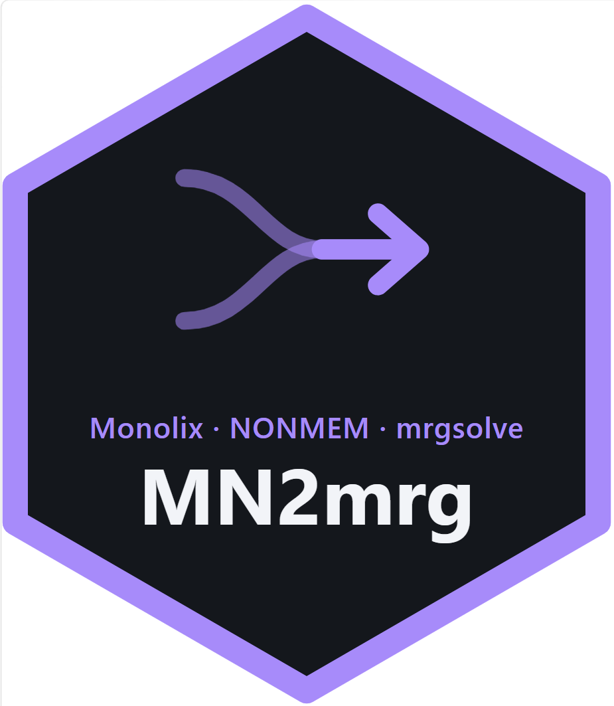
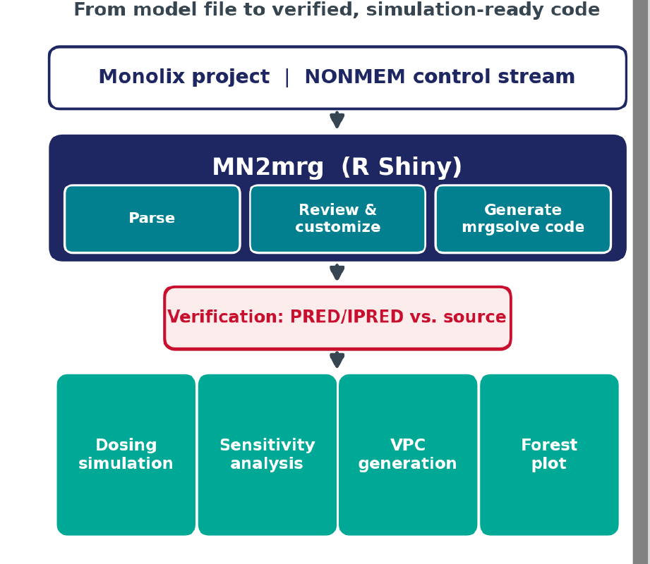
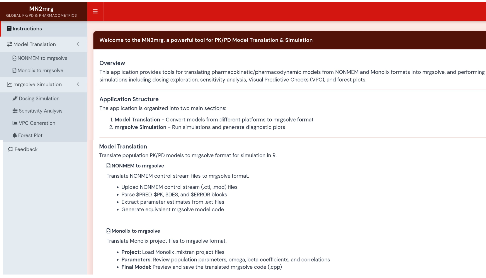
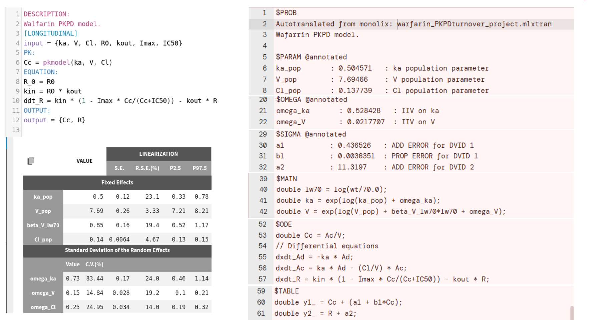
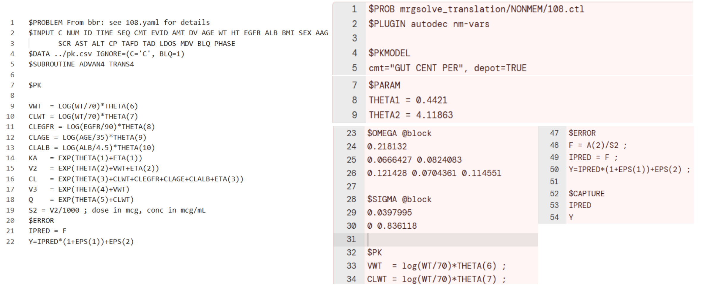
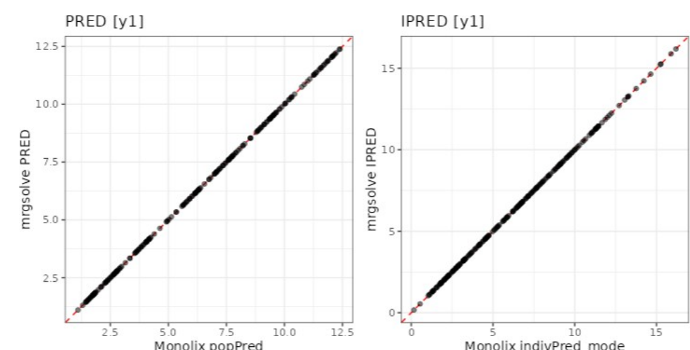
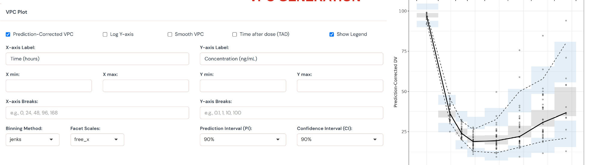
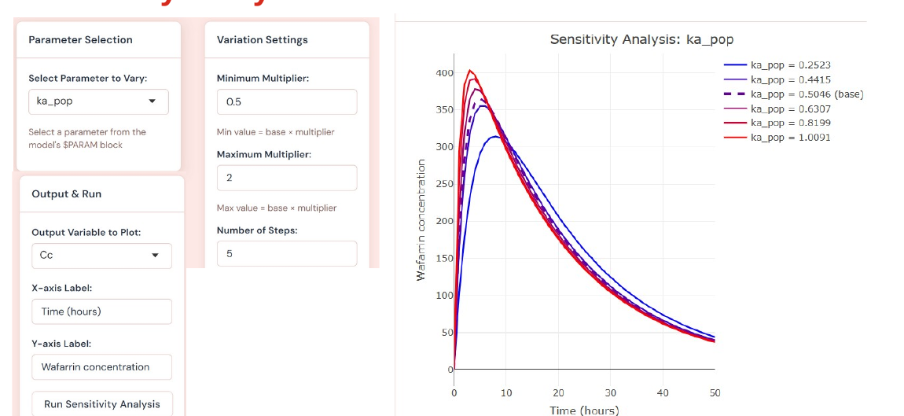
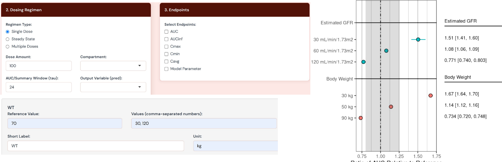
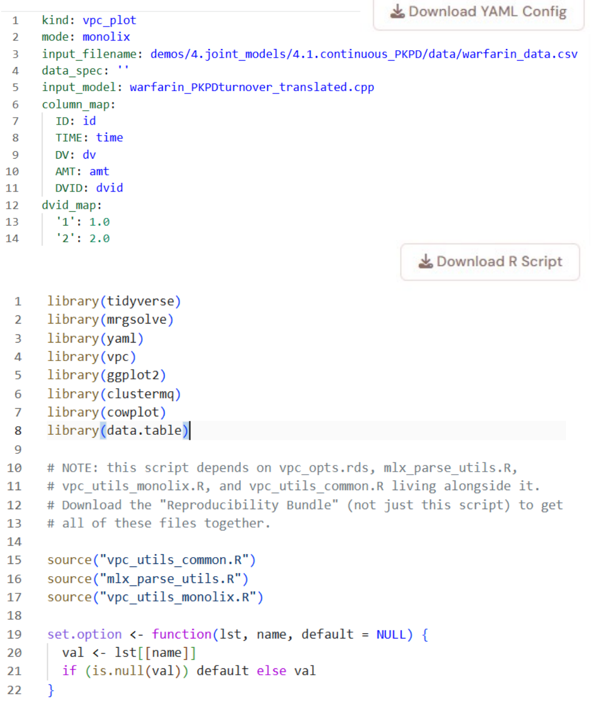

<p align="center">
  
</p>

# Getting Started with MN2mrg

**From a fitted Monolix or NONMEM model to a verified, simulation-ready mrgsolve environment, entirely in the browser.**

MN2mrg is a free, open-source R Shiny application that translates population PK/PD models from Monolix and NONMEM into [mrgsolve](https://mrgsolve.org) code, verifies the translation against the original software's predictions, and then lets you run the post-estimation work you usually need next: dosing simulations, sensitivity analysis, visual predictive checks (VPCs), and forest plots. No coding is required to use the app, and every result can be exported as YAML and R scripts so it can be reproduced outside the app.

This guide is a visual tour of what MN2mrg can do. For installation details and the programmatic API, see the [README](README.md).

> MN2mrg was presented at the 17th American Conference on Pharmacometrics (ACoP 2026), Oxon Hill, Maryland, poster **M-040**.

---

## Contents

1. [Why MN2mrg](#why-mn2mrg)
2. [Install and launch](#install-and-launch)
3. [How the workflow fits together](#how-the-workflow-fits-together)
4. [A tour of the app](#a-tour-of-the-app)
   - [Step 1: Translate your model](#step-1-translate-your-model)
   - [Step 2: Verify the translation](#step-2-verify-the-translation)
   - [Step 3: Simulate](#step-3-simulate)
   - [Step 4: Reproduce outside the app](#step-4-reproduce-outside-the-app)
5. [What the translator handles](#what-the-translator-handles)
6. [Using MN2mrg from R code](#using-mn2mrg-from-r-code)
7. [Citing MN2mrg](#citing-mn2mrg)

---

## Why MN2mrg

Monolix and NONMEM are the primary platforms for population PK/PD model estimation, but neither produces mrgsolve-compatible simulation code. In practice this means:

- **Manual re-coding is slow and error-prone.** Transcribing structural models, compartments, covariate relationships, and parameter estimates into mrgsolve takes hours per model.
- **There is no Monolix-to-mrgsolve translator.** Standalone NONMEM-to-mrgsolve tools exist, but nothing comparable has been available for Monolix, and none of them offer an interactive interface with integrated simulation.
- **Downstream plots are rebuilt ad hoc.** VPCs, dosing simulations, and forest plots tend to be written as one-off scripts on every project rather than standardized across a team.

MN2mrg addresses all three in a single browser-based tool, with built-in verification and traceability to support reproducibility and regulatory review.

---

## Install and launch

```r
# Install from GitHub
remotes::install_github("zengtaowang/MN2mrg")

# Launch the app
library(MN2mrg)
run_app()
```

`run_app()` forwards its arguments to `shiny::runApp()`, so for example `run_app(port = 8080, launch.browser = FALSE)` works as expected.

**Requirements**

- R (>= 4.4.0)
- `lixoftConnectors` is needed for **Monolix** translation only. It ships with MonolixSuite; see the [lixoftConnectors installation instructions](https://monolixsuite.slp-software.com/r-functions/2024R1/package-lixoftconnectors). The package installs, and the NONMEM paths run, without it.

---

## How the workflow fits together

<p align="center">
  
</p>

1. **Input:** a fitted Monolix project (`.mlxtran`) or a NONMEM control stream (`.ctl` / `.mod`) with its estimates.
2. **Parse, review and customize, generate:** MN2mrg reads the model and estimates, lets you review them, and writes equivalent mrgsolve code (`.cpp`).
3. **Verify:** the translated model's PRED/IPRED are compared against the predictions from Monolix or NONMEM.
4. **Simulate:** the verified model feeds directly into the dosing simulation, sensitivity analysis, VPC, and forest plot modules.

---

## A tour of the app

The app is organized into two sections in the sidebar: **Model Translation** and **mrgsolve Simulation**. The **Instructions** page summarizes what each module does.

<p align="center">
  
</p>

| Sidebar section | Module | What you do there |
| --- | --- | --- |
| Model Translation | NONMEM to mrgsolve | Upload a control stream (`.ctl`, `.mod`); MN2mrg parses `$PRED`, `$PK`, `$DES`, and `$ERROR`, extracts estimates from the `.ext` file, and generates mrgsolve code |
| Model Translation | Monolix to mrgsolve | Load a Monolix `.mlxtran` project, review population parameters, omegas, beta (covariate) coefficients, and correlations, then preview and save the translated `.cpp` |
| mrgsolve Simulation | Dosing Simulation | Explore alternative dosing regimens with the translated model |
| mrgsolve Simulation | Sensitivity Analysis | See how predictions change as selected parameters vary |
| mrgsolve Simulation | VPC Generation | Configure, simulate, and plot visual predictive checks |
| mrgsolve Simulation | Forest Plot | Quantify covariate effects on exposure across scenarios |

### Step 1: Translate your model

Both platforms are supported. Below are two examples from the poster: a warfarin PK/PD model from the Monolix demo projects (model file plus SAEM estimates) and a NONMEM two-compartment PK model with covariates, each auto-translated into equivalent mrgsolve code.

**Monolix → mrgsolve**

<p align="center">
  
</p>

**NONMEM → mrgsolve**

<p align="center">
  
</p>

In the NONMEM example, `ADVAN4 TRANS4` becomes an mrgsolve `$PKMODEL` with a depot compartment, the `THETA`s become `$PARAM` entries, the `OMEGA` and `SIGMA` blocks carry over with their estimates, and `IPRED` and `Y` are exposed through `$CAPTURE` so they are available in simulation output.

### Step 2: Verify the translation

Before simulating, check that the mrgsolve model reproduces the original fit. MN2mrg simulates PRED and IPRED with the translated model on the analysis dataset (applying the same filtering you used in Monolix or in the NONMEM `IGNORE` line) and plots them against the values from Monolix or NONMEM. Points on the line of identity mean the translation is faithful.

<p align="center">
  
</p>

### Step 3: Simulate

Once verified, the model is available to every simulation module.

**Visual predictive checks.** Choose the VPC type, axis variables, binning, and prediction intervals, then simulate in-session on the machine running the app (no job scheduler required). Multi-endpoint models are supported through DVID selection; the example shows the output for DVID 2.

<p align="center">
  
</p>

**Sensitivity analysis.** Pick a parameter and a variation range, and MN2mrg overlays the resulting profiles so you can see which parameters drive the response. The example varies ka.

<p align="center">
  
</p>

**Forest plots.** Define a dosing regimen and covariate scenarios, and MN2mrg produces a forest plot of exposure (e.g., AUC) ratios relative to a reference scenario, with medians and 90% intervals.

<p align="center">
  
</p>

**Dosing simulation.** Explore alternative regimens with the translated model directly from the Dosing Simulation page.

### Step 4: Reproduce outside the app

Every VPC and forest plot can be exported. Use **Download YAML Config** to save the plot configuration and **Download R Script** to save a script that regenerates the same output without the app. The **Reproducibility Bundle** download packages the script together with the helper files it needs as a single `.zip`, which is the recommended option for submission archives.

<p align="center">
  
</p>

---

## What the translator handles

| Feature | What it handles |
| --- | --- |
| Monolix library models | Translation of most Monolix library PK/PD models to mrgsolve (e.g., `oral1_1cpt_kaVCl.txt`) |
| NONMEM subroutines | Translation of most NONMEM subroutines to mrgsolve (e.g., ADVAN 1, 2, 3, 4) |
| Auto covariate detection | Recognizes continuous and categorical covariates defined in Monolix and applies their transformations (e.g., `logWT = log(WT/70)`) |
| Alphanumeric DVIDs | Monolix accepts alphanumeric DVID columns; MN2mrg converts them to numeric values compatible with mrgsolve |
| Inter-occasion variability (IOV) | Parses IOV defined in Monolix through the occasion column and GUI setup into the mrgsolve `$OMEGA` section |
| IPRED/PRED verification | Compares mrgsolve-simulated IPRED/PRED against Monolix or NONMEM output |
| Auto dataset filtration | Applies filtering conditions (Monolix GUI or NONMEM `IGNORE`) when generating verification and VPC plots |
| Downloadable YAML/R scripts | Exports YAML configuration and R scripts to reproduce in-app VPCs and forest plots outside the app |

---

## Using MN2mrg from R code

Every button in the app is a thin wrapper around an exported package function, so the same workflow can be scripted, embedded in a Quarto report, or run in batch. A minimal NONMEM translation:

```r
library(MN2mrg)

res <- nonmem2mrgsolve("path/to/run.mod")
writeLines(res$code, "run.cpp")
```

See the [README](README.md#programmatic-use) for a complete scripted VPC example.

---

## Citing MN2mrg

If MN2mrg helps your work, please cite:

> Wang Z, Heathman MA, Kim SJ, Miles S, Vélez de Mendizábal N. *MN2mrg: An Open-Source R Shiny Application for Automated Translation of Monolix and NONMEM Models to mrgsolve for Simulation Workflows.* Poster M-040, 17th American Conference on Pharmacometrics (ACoP), Oxon Hill, Maryland, October 11–14, 2026.

Questions, bugs, and feature requests are welcome on the [issue tracker](https://github.com/zengtaowang/MN2mrg/issues).
